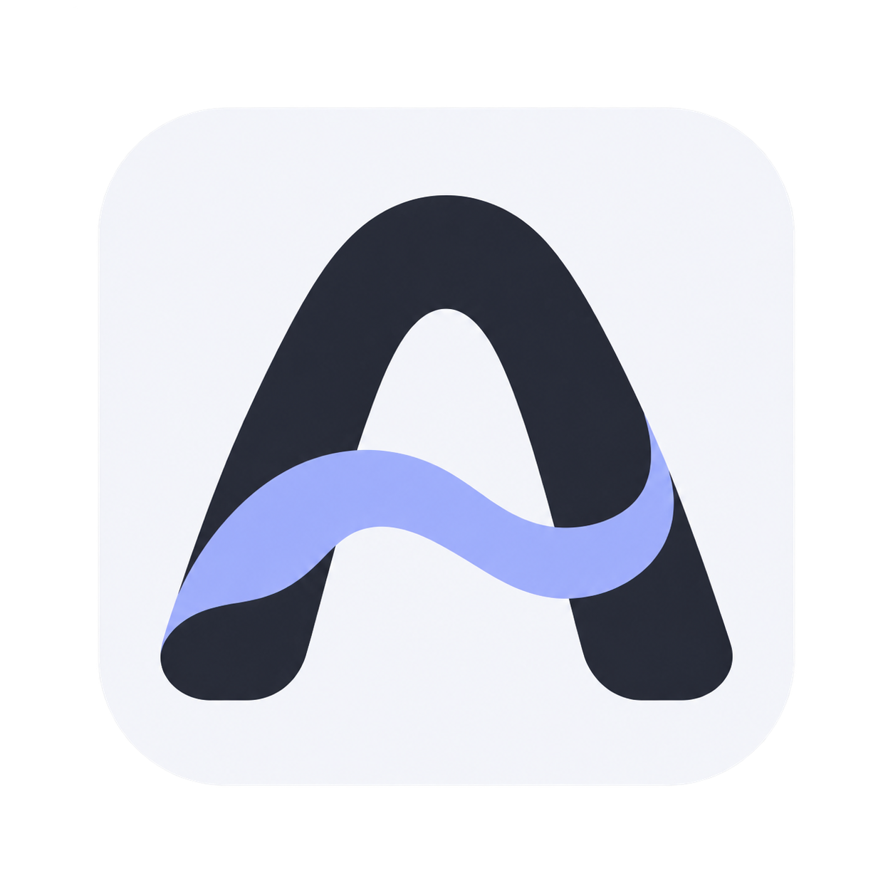
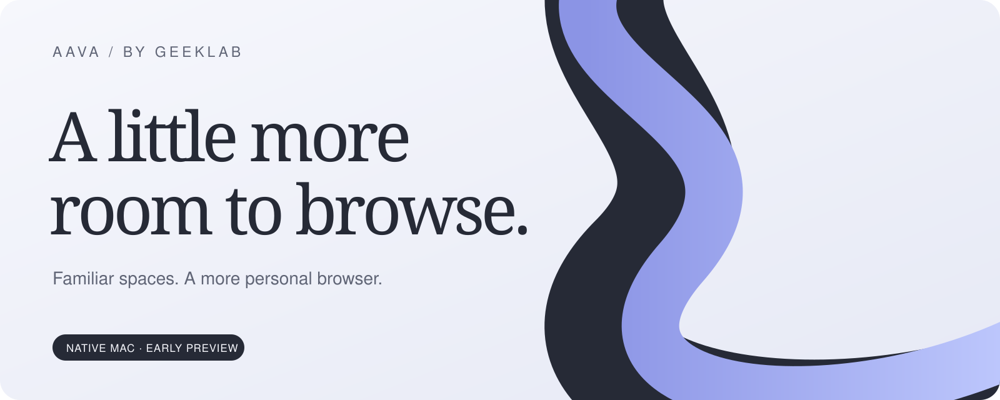
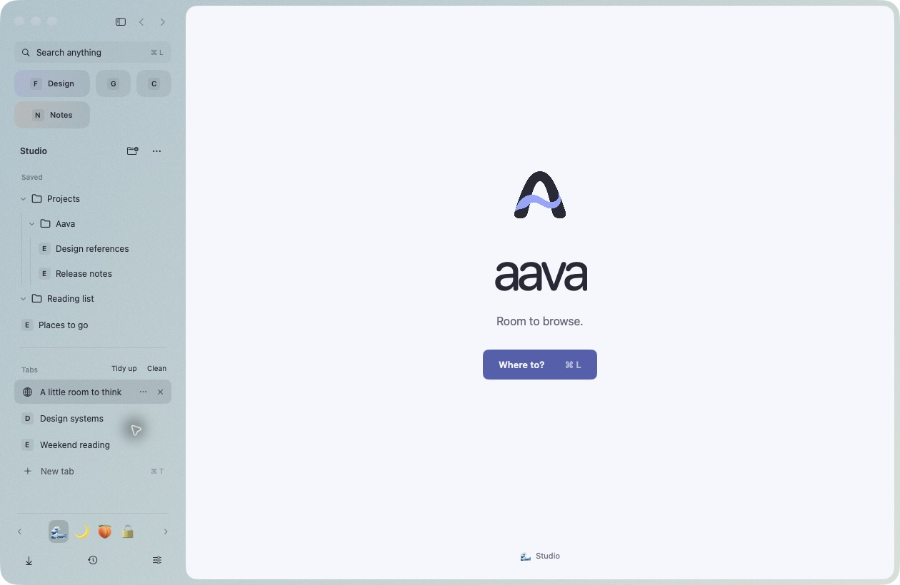
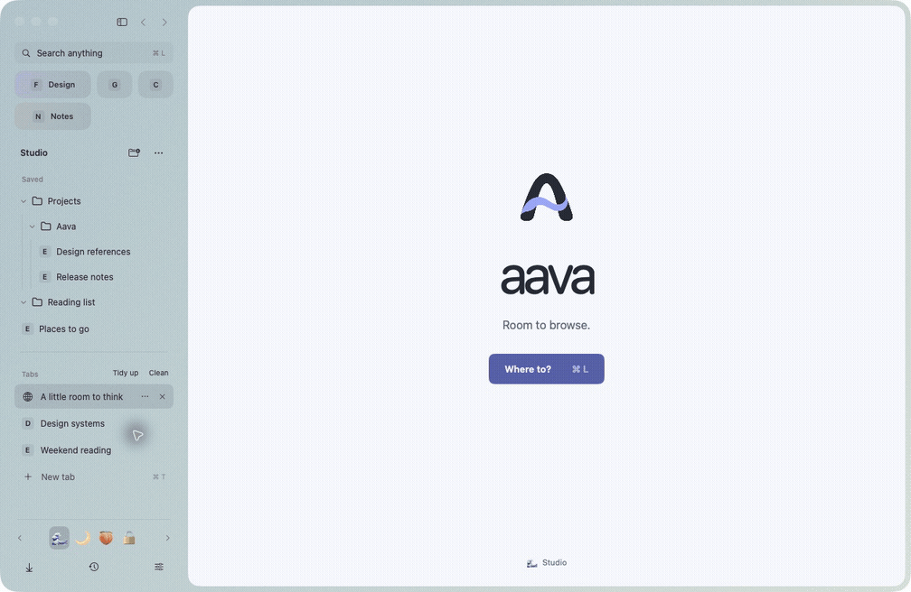
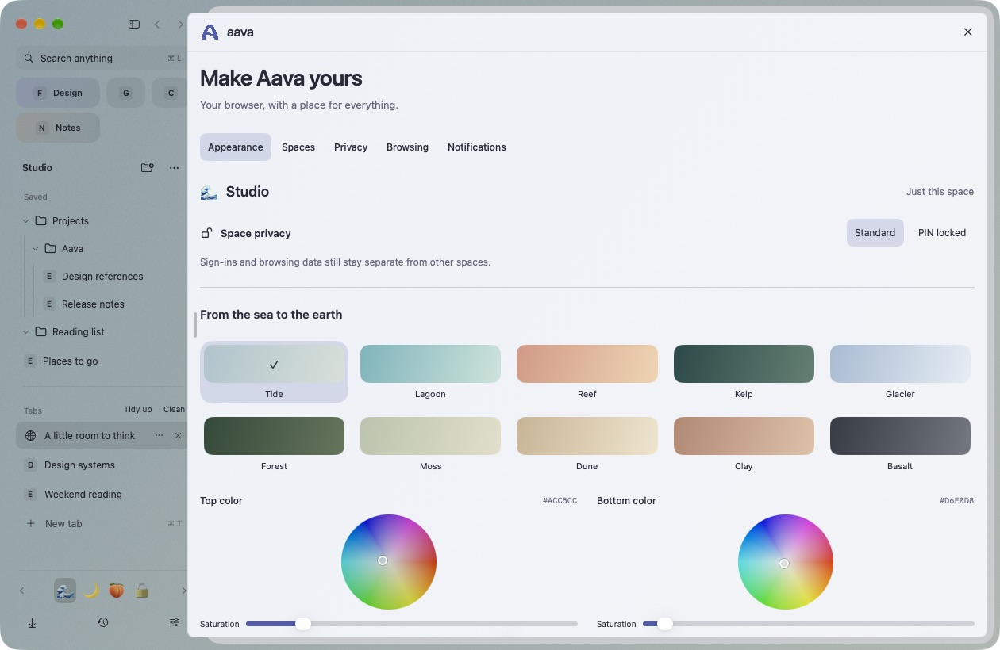
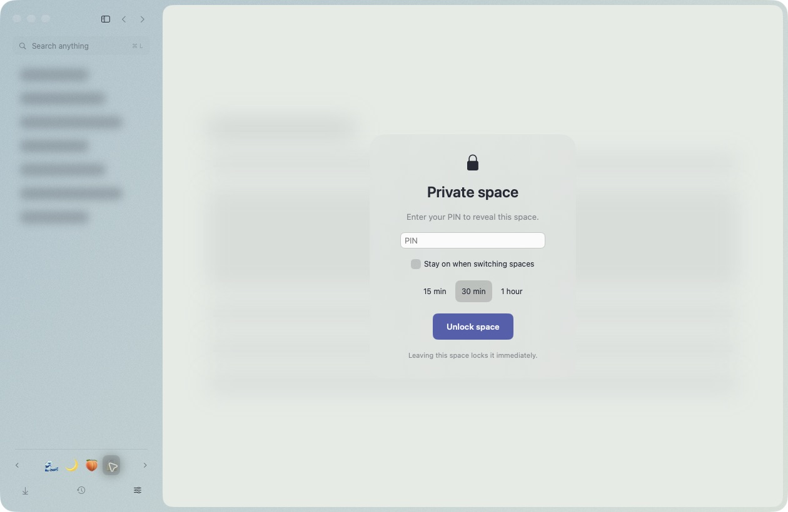
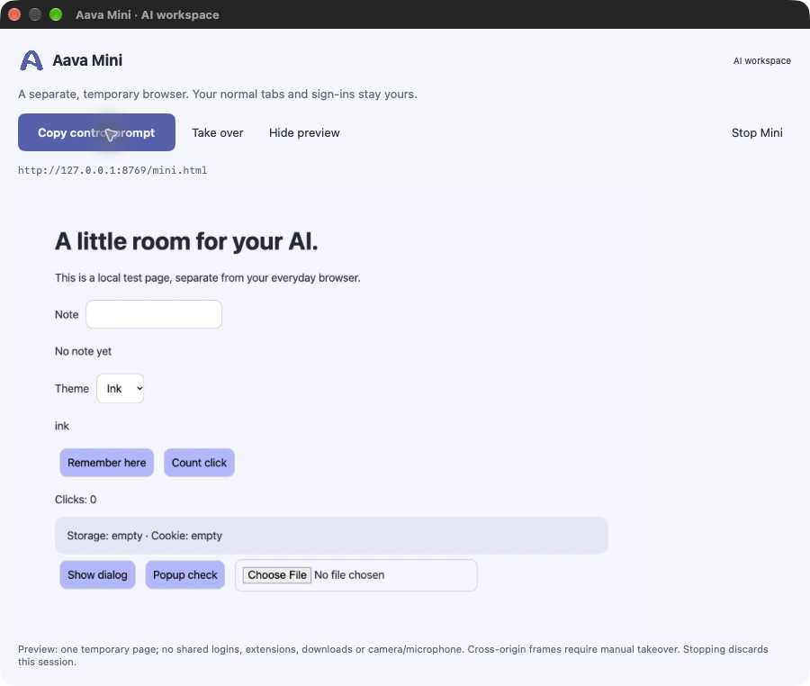
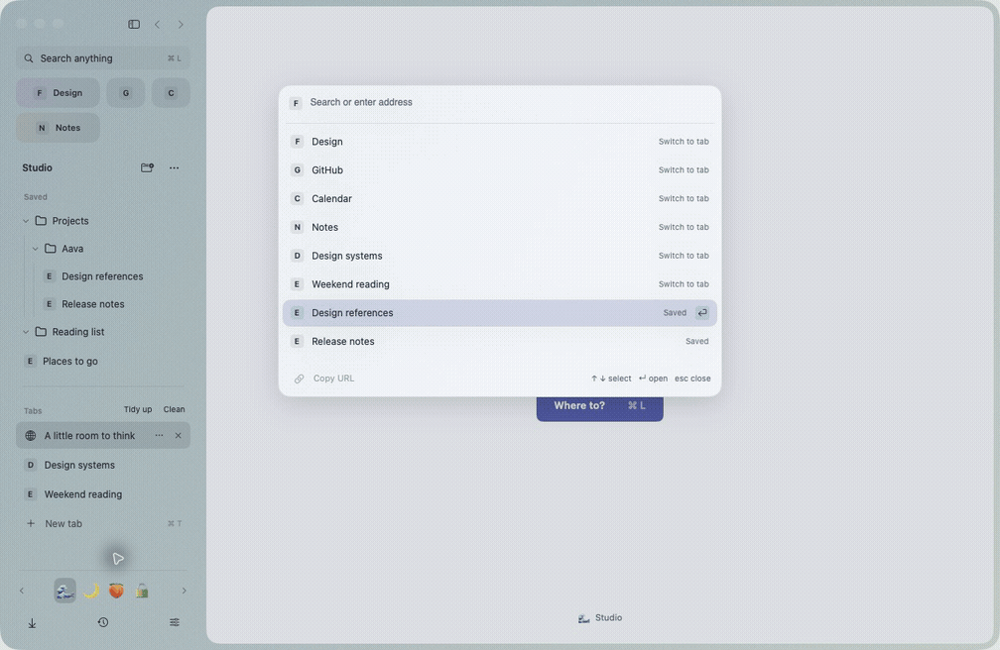

<p align="center">
  
</p>
<h1 align="center">aava</h1>
<p align="center"><strong>Room to browse.</strong><br>A personal Mac browser, by Geeklab.</p>
<p align="center">
  <a href="#a-familiar-place-a-few-new-possibilities">Explore</a> ·
  <a href="#coming-from-arc">Compare with Arc</a> ·
  <a href="https://github.com/jesseglab/aava/releases/tag/v0.3.0-alpha.2">Download preview</a> ·
  <a href="docs/public/BUILDING.md">Build for Mac</a> ·
  <a href="docs/public/PREVIEW-STATUS.md">Preview status</a>
</p>



Aava brings the sidebar you love into a browser you can make your own. Keep projects in separate spaces, give important tabs a permanent home, and let AI work in a separate Mini session while you keep browsing.

**Native SwiftUI/AppKit shell. Chromium for websites. Direct Mac release first.**

> **0.3.0-alpha.2 · Signed developer preview · Build 6**<br>
> This is a working browser in active development. The download is Developer ID signed by Geeklab, but **not yet notarized**. Dark Reader has passed initial native checks; broader extension compatibility, real Meet/Teams calls and popouts, and a production update service remain unfinished. macOS may block the download until notarization is complete. [What works, what is tested, and what is next →](docs/public/PREVIEW-STATUS.md)



*Actual native app. All screenshots use a sample workspace, with no personal browsing data.*

## A familiar place. A few new possibilities.

### A space for every side of you

Work, after hours, a new idea. Move between emoji spaces, each with its own tabs, saved folders, colors and **independent browsing profile**. Sign-ins and site storage stay separate between spaces.



*Captured-state tour of three spaces; not a recording of transition speed.*

### Make yourself at home

Choose from ten nature-inspired presets or start with a color wheel. Add an image or GIF, adjust transparency and noise, and choose Lucide, Heroicons or emoji artwork. Favorite tiles can span one or two columns, with a name and a soft color tint.



### A little privacy, on your terms

PIN-locked spaces blur the page and sidebar until unlocked. Keep a space unlocked while moving around, or have it relock after **15 minutes, 30 minutes or an hour** of inactivity.



*The PIN is a local interface lock. It does not encrypt the entire browsing profile on disk.*

### Your AI works. You keep browsing.

Mini is a separate, temporary Chromium session with a viewable preview. Give a local coding agent its copyable control prompt, watch what it does, take over, or stop the session. Your everyday tabs and sign-ins stay in the main browser.



*Mini shown with a local test page. The agent needs local command access; a chat website alone cannot connect. Mini does not share ordinary profiles, extensions, downloads or camera/microphone access.*

### Small details that earn their place

- **Find your way with ⌘T.** Search open tabs, saved pages, history and archived tabs from one compact panel.
- **Keep the good stuff.** Nested folders, favorite tiles, GitHub PR folders grouped by repository, and a download tray close at hand.
- **Clear some room.** Tidy and clean tabs, then find closed pages again in the archive.
- **Make fewer duplicate tabs.** A same-domain link can ask whether to open a new tab or replace the current one. Hover to pause; remember the choice for that domain.
- **Fit the way you work.** Resize the sidebar or keep dragging left to collapse it. Swipe over the space switcher or use the keyboard.



*Tour assembled from native captures. The full [screenshot gallery](docs/media) includes still images.*

## Coming from Arc

The point is to keep the familiar habits and add room for your own. Aava is an independent project, not an official Arc continuation.

| | Arc on Mac | Aava developer preview |
|---|---|---|
| Spaces, vertical tabs, nested folders | Familiar core workflow | Yes, with a native sidebar |
| Browsing profiles | A profile can serve multiple spaces | A separate profile for every space |
| Favorites | Shared within a profile | Per-space tiles, one/two-column sizing, names and tints |
| Personalization | Colors, gradients and tab icons | Ten presets, color wheels, image/GIF backgrounds, noise, transparency and glass |
| Private space lock | Not described in the cited Arc docs | PIN, blurred content and timed relocking; not disk encryption |
| Small browser window | Little Arc for quick browsing | Isolated Mini for local AI control, with preview, take-over and stop |
| GitHub folders and tab archive | Existing Arc features | PR/repository folders, tidy/clean and searchable history/archive |
| Chrome extensions | Documented Chrome Web Store workflow | Chromium integration; broad compatibility still being tested |
| Call/video popouts | Mini Player | Implemented; real Meet/Teams validation pending |
| Sync and mobile | Documented sync and other platforms | Local Mac preview; iPhone/iPad comes later |
| Memory and battery | Established browser | Native shell and lazy tabs; no comparative benchmark yet |

[Detailed comparison and primary Arc sources →](docs/public/ARC-COMPARISON.md)

**Bring your workspace along.** Import Arc spaces, favorites, pins and nested folders. A separate importer offers bookmarks, history, an extension restore list and optional supported cookie transfer into a fresh space. Source profiles are read-only. Extensions are not automatically installed; some sites require signing in again. Password CSV import is separate, and passkeys do not transfer.

## Build the preview

**Apple Silicon · macOS 14+**<br>
Requires Xcode command-line tools, Swift 5.10+, CMake, Python 3 and several GB of free space.

```sh
git clone https://github.com/jesseglab/aava.git
cd aava
python3 scripts/fetch-cef.py
./scripts/build-mac.sh
open build/mac/Aava.app
```

The source-build command above produces a locally ad-hoc signed build. The GitHub preview download is separately Developer ID signed by Geeklab. It is not a notarized release or Mac App Store archive. [Build, signing and test details →](docs/public/BUILDING.md)

```sh
swift test
```

**93 core tests pass** for this preview. Synthetic native checks cover selected import, isolation and Mini workflows. They do not establish production readiness or broad extension/site compatibility.

<details>
<summary><strong>A few useful shortcuts</strong></summary>

| Action | Shortcut |
|---|---|
| New tab / command panel | ⌘T |
| Address / search | ⌘L |
| Close tab | ⌘W |
| Reload | ⌘R |
| Save current page | ⌘D |
| Copy URL | ⇧⌘C |
| Previous / next space | ⌥⌘[ / ⌥⌘] |
| Lock private spaces | ⇧⌘L |

</details>

<details>
<summary><strong>Under the surface</strong></summary>

The interface uses SwiftUI and AppKit rather than an Electron UI renderer. Sites use Chromium Embedded Framework (CEF), pinned in `Apps/macOS/cef-version.json`. Saved pages and restored inactive tabs do not create page renderers; live tabs keep their state until explicitly put to sleep.

Each space owns a persistent Chromium request context. Mini uses a separate temporary profile and an authenticated local Unix socket. No remote debugging port is enabled by default.

CEF is not the full Google Chrome product. Some extension APIs, browser services, media formats and DRM need separate validation. Automatic safe tab discarding, a production update system and measured performance remain work ahead.

</details>

## Made by Geeklab

Mac first. iPhone and iPad later. Chromium stays on Mac so extension compatibility remains a priority.

[Report a bug](https://github.com/jesseglab/aava/issues/new?template=bug-report.yml) · [Security](SECURITY.md) · [Contributing](CONTRIBUTING.md) · [Notices](NOTICE.md)

Copyright © 2026 Geeklab Oy. An open-source license has not yet been selected for Aava’s original code and branding. Third-party components retain their own licenses. Arc is a trademark of its respective owner; Aava is not affiliated with The Browser Company.
